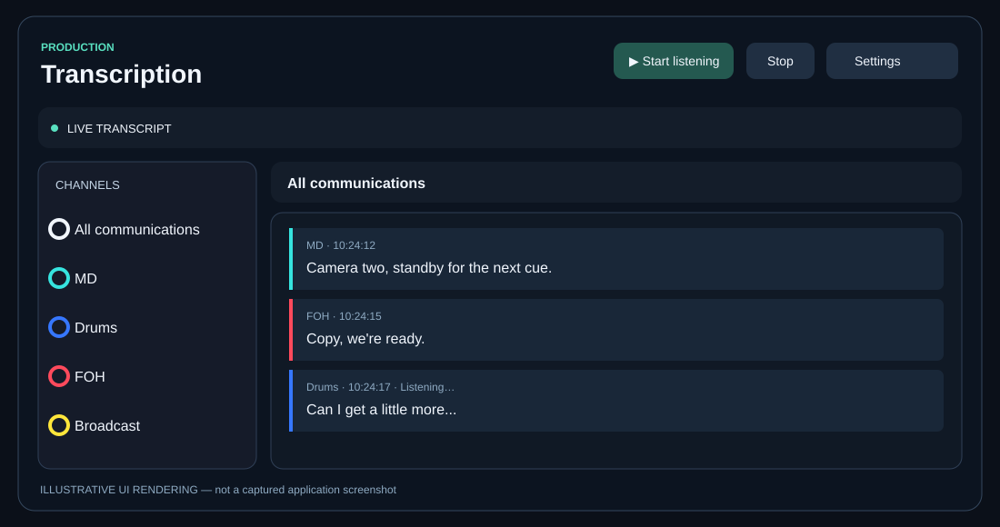
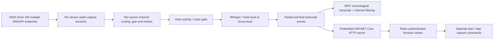

# Production Transcription

**A Windows-native, multi-source, live-production communications transcription workstation.** Capture separate intercom, FOH, broadcast, stage, camera, and other audio channels; transcribe them into one chronological feed; and follow the conversation from the workstation or an optional browser viewer.

> **Project status:** Active development / field testing. The application implements live capture and transcription, but the current feature branch is not a certified production release. Test device compatibility, latency, model performance, web access, and installer behavior before relying on it during a show.



*Illustrative UI rendering, not an actual application screenshot. Actual desktop and Settings screenshots can be added when captured and committed to the repository.*

## What it does

- **Multiple independent channels:** Configure named, color-coded logical sources with enable/disable, input number, per-source gain, noise gate, and metering.
- **Two audio backend modes:** ASIO uses one selected ASIO driver with individually assigned input channels. WDM/WASAPI can capture **multiple stereo recording endpoints simultaneously**, with each source selecting its own endpoint and its own channel.
- **Dante-friendly:** Works with Windows recording endpoints exposed by Dante Virtual Soundcard or other drivers; not tied to a particular console, brand, or Dante API.
- **Real-time AI speech recognition:** Local CPU-based **Whisper** and **Vosk** options; optional cloud recognition using **Groq** and a user-supplied API key. Recognition profiles include Speed First, Balanced (default), and Accuracy First.
- **Live partials and finalized messages:** Whisper produces rolling partial hypotheses, then finalizes utterances. Results appear in a unified, timestamped transcript.
- **Production-focused transcript UI:** Filter by channel, mute sources, reorder source cards by drag handle, use compact mode, toggle light/dark appearance, and color-code speakers.
- **Noise-caption cleanup:** A conservative Whisper text filter removes recognizable bracketed sound captions such as `(gentle music)` or `[applause]` while retaining spoken text.
- **Profanity censoring:** The desktop transcript and the remote snapshot apply the application's transcript censor.
- **Remote browser access:** Optional embedded web viewer with channel selection, bearer-token access, configurable TCP port and IPv4 listening interface. Read-only mode displays transcripts; read/write mode additionally permits **starting and stopping capture**.
- **Session-oriented:** Configuration persists locally; transcript messages are in memory for the running session. The audio capture code does not write recordings to disk.
- **Windows packaging:** Self-contained x64 portable build and Inno Setup installer produced by GitHub Actions, with custom app branding.

## Architecture



**Technical stack:** C# / .NET 10, WPF, NAudio (ASIO and WASAPI capture), Whisper.net, Vosk, optional Groq integration, ASP.NET Core/Kestrel, JSON settings, and Inno Setup. Source code is under `src/ProductionTranscription.App/`. See [requirements](docs/requirements.md) and [web viewer design/operations](docs/web-viewer.md).

### Audio routing model

The app operates in **one backend mode at a time**:

| Mode | Device selection | Meaning of Input # |
| --- | --- | --- |
| **WDM / WASAPI** | Each source can select its own recording endpoint; the left-side **Fallback audio device** is used when a source has no explicit endpoint | **Local to that endpoint**. On a stereo device, `1` = left and `2` = right. |
| **ASIO** | Select one ASIO driver globally | Channel number exposed by that ASIO driver, starting at `1`. |

In WASAPI mode, sources using the same endpoint share a capture session; sources assigned to different endpoints run through separate sessions. For example, three DVS stereo pairs can supply six logical sources:

| Logical source | WASAPI recording endpoint | Input # |
| --- | --- | --- |
| MD | DVS Receive 1–2 | 1 |
| Drums | DVS Receive 1–2 | 2 |
| FOH | DVS Receive 3–4 | 1 |
| Broadcast A | DVS Receive 3–4 | 2 |
| Broadcast V | DVS Receive 5–6 | 1 |
| Headset TX | DVS Receive 5–6 | 2 |

These are **illustrative names and assignments**; choose the endpoints actually present on your PC. Do not number inputs globally across WASAPI endpoints (e.g., 5 or 6 on a stereo pair). An endpoint exposing two channels accepts only inputs 1 and 2.

### Recognition behavior and limits

- Whisper is configured for English and operates on 16 kHz audio after resampling. It generates rolling partials at roughly two-second intervals and finalizes speech after a silence threshold or maximum utterance duration.
- Local recognition runs without sending audio to a cloud service. CPU throughput and latency depend on the number of active channels, selected model, machine hardware, and simultaneous speech. **Multiple sources do not guarantee simultaneous inference at full real-time speed.**
- Groq is an **optional cloud** mode: using it sends audio to the provider. It requires network access and credentials; do not select it when audio must remain offline.
- The noise-caption filter handles recognized bracketed descriptions, not every possible hallucination or non-speech phrase. It is not a guarantee of perfect transcription.
- The audio pipeline currently uses a fixed initial 48 kHz ASIO capture rate; some hardware may require additional rate negotiation.

## Getting started — Windows

### Option A: Installer (recommended for testing)

1. Open [GitHub Actions → Windows build](../../actions/workflows/windows-build.yml) for the desired branch and select a **successful** run.
2. Download the `production-transcription-installer` artifact and extract it.
3. Run `ProductionTranscription-Setup.exe`. The installer installs the app and offers a desktop shortcut. Administrative approval may be required.
4. Launch **Production Transcription** and open **Settings**.

> GitHub Actions artifacts may require signing in to GitHub. A committed workflow does not guarantee that a particular run has succeeded; inspect the run and its logs.

### Option B: Portable build

Download and extract the `production-transcription-windows-x64` artifact from a successful Windows build run, then launch `ProductionTranscription.exe`. The workflow publishes a self-contained Windows x64 build; the application is intended for Windows, not macOS or Linux.

### Option C: Build from source

Install the **.NET 10 SDK** on Windows. The build generates the ICO/PNG branding assets using Python and Pillow, so create those assets first:

```powershell
git clone https://github.com/j0nvinci/production-transcription.git
cd production-transcription
git switch feature/web-viewer

py -m pip install Pillow
py tools/generate_icon.py

dotnet restore src/ProductionTranscription.App/ProductionTranscription.App.csproj
dotnet build src/ProductionTranscription.App/ProductionTranscription.App.csproj -c Release
dotnet run --project src/ProductionTranscription.App/ProductionTranscription.App.csproj -c Release
```

To produce a portable self-contained build:

```powershell
dotnet publish src/ProductionTranscription.App/ProductionTranscription.App.csproj -c Release -r win-x64 --self-contained true -p:PublishSingleFile=true -o artifacts/windows-x64
```

### Step 1 — Install an audio driver and verify the Windows inputs

For **WASAPI**, make sure the desired sources appear as **Windows recording endpoints**. For Dante Virtual Soundcard, configure DVS and your Dante subscriptions/routing first; then confirm that Windows exposes the intended receive pairs. For **ASIO**, install the hardware manufacturer's ASIO driver and confirm that the driver exposes the required input channels.

The application does **not** create Dante routes or configure your audio console. It consumes audio presented by the installed Windows drivers.

### Step 2 — Choose the backend and audio devices

1. Open **Settings → Audio input**.
2. Select **WDM / WASAPI** for multiple Windows recording endpoints, or **ASIO** for a single multi-input ASIO driver.
3. In WASAPI mode, optionally select a **Fallback audio device**. A source-specific device assignment takes precedence.
4. Click **Refresh** if newly installed recording devices are not listed.

### Step 3 — Create and map sources

1. Under **Channel routing & processing**, click **+ Add source** for each production channel.
2. Give every source a clear name (e.g., MD, FOH, Cameras, Stream).
3. In WASAPI mode, select the source's recording endpoint and choose its local **Input #** (usually `1` or `2` for a stereo pair). In ASIO mode, choose the corresponding driver input.
4. Enable the source using **On**. Expand **Color, gain and gate** to set its appearance, input gain, and speech/noise threshold.
5. Drag the turquoise handle to reorder source cards. Your configuration is saved across launches.

**Important:** Audio routing and recognition controls are intentionally restricted while capture is running. Stop capture before changing drivers, endpoints, or models.

### Step 4 — Set up speech recognition

1. Open **Settings → Recognition engine**.
2. For local Whisper, obtain a compatible Whisper **GGML model file** (for example, a base English model) and place it in:
   ```text
   <application folder>\models\
   ```
   For Vosk, extract a compatible Vosk model directory into the same `models` folder. The app scans Whisper `.bin` files and Vosk model directories.
3. Click **Refresh models**, choose the recognition engine, and select the detected model.
4. Select the AI profile; **Balanced** is the default.
5. For optional Groq cloud recognition, choose Groq, select the provider model, and enter the API key in the Settings password field. Cloud recognition is not offline.

For installed builds under `Program Files`, the application directory may require administrator rights to modify. Place model files there during setup or use a writable portable installation.

### Step 5 — Start a test capture

1. Confirm each source is receiving audio using its meter.
2. Click **Start listening** (or start capture from Settings).
3. Speak into one channel at a time to confirm that names, physical inputs, and transcripts match.
4. Test two or more sources at once and observe recognition latency on your hardware.
5. Use the channel sidebar to show one channel or **All communications**; optionally mute individual sources.
6. Click **Stop** when finished.

## Remote web viewer

The web viewer runs **inside the Windows desktop app**. It is disabled by default and does not perform capture or recognition on the browser device.

1. In **Settings → Web viewer**, enable **Enable web UI**.
2. Choose **Listening network interface**:
   - **Localhost (127.0.0.1)**: this PC only.
   - **A specific local IPv4 address**: one selected network interface/address.
   - **All network interfaces (0.0.0.0)**: all IPv4 interfaces.
3. Set the **TCP port** (default: **8765**).
4. Choose **Read only** for viewing, or **Read/write** to permit remote **Start capture** and **Stop capture**.
5. Copy the **Access token** from Settings. The token is required to view transcript data or issue control requests.
6. From another authorized device on the trusted LAN/VPN, visit `http://<windows-pc-ip>:8765/`, substituting your configured address and port. Enter the token and click **Connect**.

The viewer supports independent channel filtering and updates via HTTP snapshot polling (approximately every 750 ms); **WebSockets are not yet implemented**. Regenerating the token invalidates the old token. Read/write access does **not** allow changing source settings or recognition configuration.

**Security warning:** The web server currently uses **unencrypted HTTP**, not HTTPS. The access token and transcript can be intercepted on an untrusted network. **Never expose the port directly to the public internet.** Use a trusted LAN/VPN, and restrict inbound Windows Firewall rules to the intended private network and trusted clients. If the viewer is unavailable, check the listener status in Settings, IP binding, port conflicts, Windows Firewall, and whether the PC is reachable.

For details, see [Web viewer operations and limitations](docs/web-viewer.md).

## Settings, data, and privacy

- Settings file: `%LOCALAPPDATA%\ProductionTranscription\settings.json`.
- Source names, channel mapping, gain/gate, UI options, web bind address, web permissions, and the web access token are stored there.
- **Treat this file as sensitive**: it contains the web access token. Restrict local file access and avoid posting the file publicly.
- The optional Groq API key is handled separately by the application's credential store.
- The desktop transcript is session-oriented; the UI retains a bounded number of recent messages in memory. The application does not provide an archival recording system or guarantee transcript persistence after restart.
- Cloud recognition sends gated speech audio to the selected provider; local recognition does not.

## Troubleshooting

| Symptom | Check |
| --- | --- |
| No audio input devices | Install/enable the appropriate driver; confirm Windows recording endpoints or ASIO driver; click **Refresh**. |
| “Requested input 5 … endpoint exposes only 2 channels” | In WASAPI mode, change that source's Input # to `1` or `2` on its assigned stereo endpoint. |
| Transcript empty despite meters moving | Verify the recognition model is detected, the correct engine is selected, speech is above the gate threshold, and the CPU can process the active channel count. |
| Speech attributed to the wrong channel | Recheck the device **and** local Input # on each source, plus the physical Dante/console routing. |
| No models detected | Check the `models` directory next to the executable; click **Refresh models** and select the correct engine. |
| Settings are disabled | Stop active capture before changing the audio backend, endpoint assignments, or recognition model. |
| Web listener fails to bind | Another program may already be using the port, or the selected IP is not assigned to this PC. Choose an available port/address. |
| Browser cannot connect | Verify **Enable web UI**, listener status, correct PC IP and port, firewall allowance, VPN/LAN connectivity, and token. |
| Recognition lags | Try fewer simultaneous channels, a smaller local model, or the Speed First profile; benchmark under realistic show conditions. |

## Development and build outputs

- Application: `src/ProductionTranscription.App/`
- Shared settings and audio-source model: `Models/AppSettings.cs`
- Audio capture/routing: `Services/AudioCaptureSession.cs`, `Services/MultiDeviceAudioCapture.cs`
- Whisper transcription: `Services/WhisperTranscription.cs`
- Embedded viewer: `Services/WebViewerHost.cs`
- Windows installer definition: `installer/ProductionTranscription.iss`
- Icon generator: `tools/generate_icon.py`
- CI workflow: `.github/workflows/windows-build.yml`

The CI workflow builds the app on Windows, publishes a self-contained x64 artifact, then uses Inno Setup to produce `ProductionTranscription-Setup.exe` and a SHA-256 checksum file. Inspect [GitHub Actions](../../actions) for the status of a specific revision.

## Known limitations / roadmap

- Audio device/driver compatibility, capture recovery, and installer behavior need broader hardware testing.
- Whisper inference on multiple CPU-only channels can become a bottleneck; tune models and channel count to the target PC.
- Remote access is HTTP and uses polling, not HTTPS/WebSockets; hardening and performance testing remain.
- ASIO rate negotiation is currently limited.
- A comprehensive automated UI/end-to-end test suite and signed release distribution are not yet in place.

This project is designed for **production communications awareness**, not as a safety-critical replacement for an intercom, audio monitor, or human operator.
